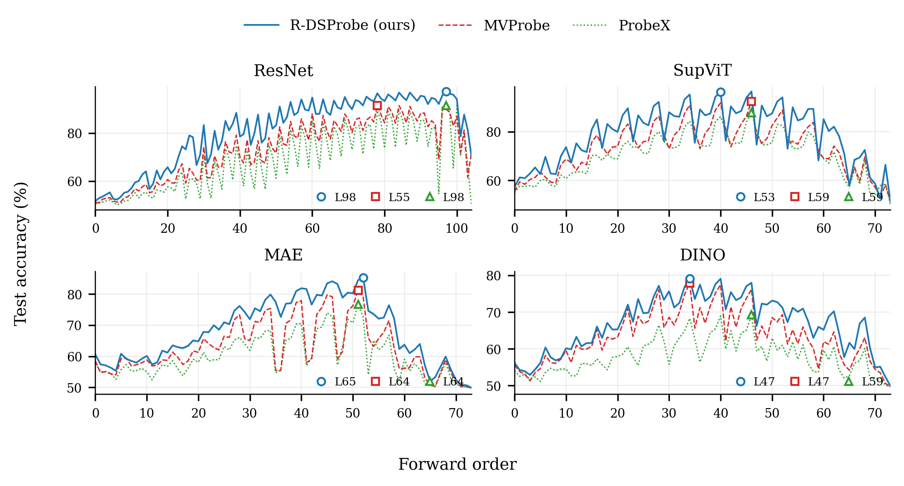
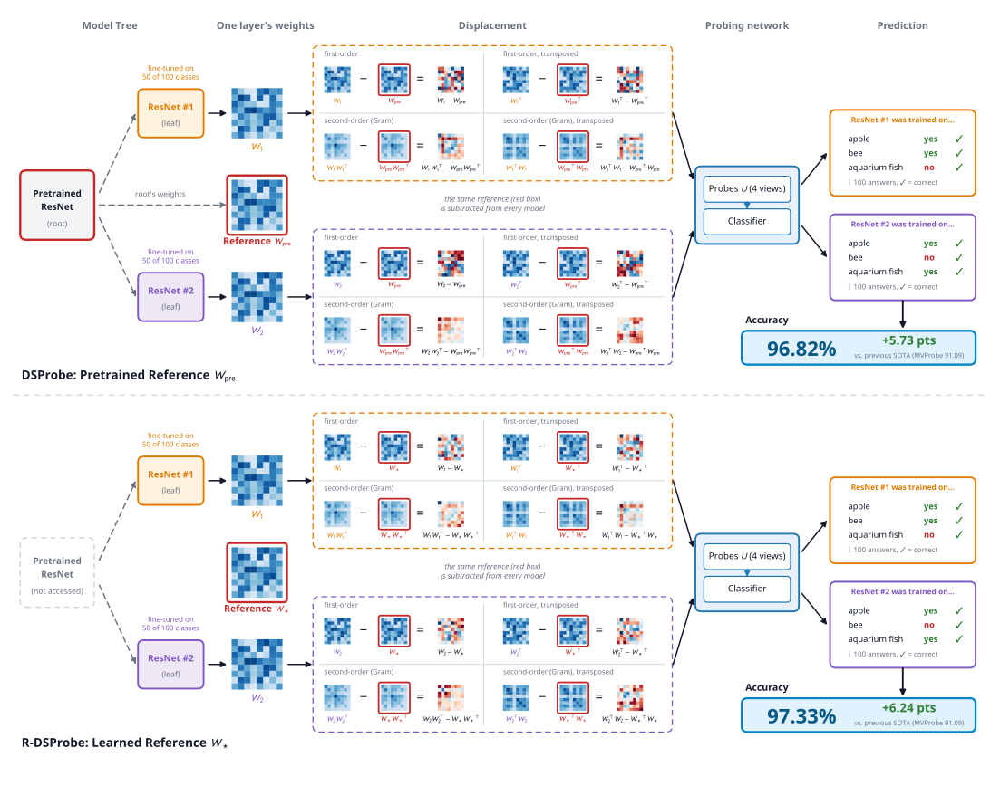

# The Reference Matters: Displacement Probing for Weight-Space Learning

Official PyTorch implementation of **DSProbe** (DiSplacement Probe) and **R-DSProbe** (Refined DiSplacement Probe).

[](https://arxiv.org/abs/2611.33998)

> **Note on collaboration.** This codebase was developed jointly by
> [Haechan Shin](https://github.com/hcvir) and [Hoonki Lee](https://github.com/hoonki2002).
> Please see the paper for the full author list and contributions.

<p align="center">
  
</p>

*Layer-wise test accuracy on Model Jungle (source-class membership). The markers
show the layer each method selects on the validation set.*

**Weight-space learning** predicts a model's attributes, such as the data it was
trained on, directly from its weights, without running the model and without
relying on documentation. This is useful because most public models come with
little of it. A *metanetwork* takes another model's weights as input, but these
are large, so **probing** reads them cheaply: it multiplies a layer's weight
matrix by a small set of learned vectors (the *probes*) and represents the model
by these responses, which a classifier maps to the attribute. (Stable Diffusion
LoRAs are probed in the same way, to predict the ImageNet class they were trained
for.)

**This paper introduces a simple and obvious trick to enhance probing accuracy:
subtracting the reference.**

<p align="center">
  
</p>

Probing on a Model Tree. A reference (red) is subtracted from each leaf's weights and from
their Gram matrices $WW^\top$, which gives first- and second-order displacements (and their
transposes). A single probing network, with four views and learned probes $U$, maps them to
the classes the model was trained on. Top: DSProbe uses the root's weights $W_{\mathrm{pre}}$
as the reference. Bottom: R-DSProbe needs no access to the root; its reference $W_\star$ is
learned during training (starting from the mean of the training leaves) and then kept fixed.

Models in a Model Tree are fine-tuned from the same pretrained model, so their weights look
alike and what distinguishes them is their **displacement** from it. **DSProbe** probes the
displacement instead of the raw weight. **R-DSProbe** goes further and **learns** the shared
reference to subtract, which also removes the need for the pretrained model.

In Model Jungle, each model is a network fine-tuned on a random 50 of the 100 CIFAR-100
classes, and the task is to tell, **from its weights alone, which classes it was trained
on**: 100 yes/no questions per model, of which guessing gets 50% right. On ResNet, the
previous best probing method (MVProbe) answers about 91 of the 100 correctly, while
**R-DSProbe answers about 97 correctly (97.33%)**. It is the best method on all four
architectures we study.

## Highlights

- **State of the art** on the four architectures of Model Jungle (ResNet, SupViT,
  MAE, DINO) and on Stable Diffusion LoRA (in-distribution and zero-shot).
- **Why Gram views work.** We connect a layer's Gram matrix to the learning signal of
  fine-tuning: how the Gram changes reflects the features the model learned. This explains
  why second-order views help, and subtracting the reference isolates exactly this change.
- **No pretrained model needed.** R-DSProbe starts from the mean of the training leaves of
  each tree and learns its reference from there.
- **One shared encoder for all Model Trees.** It still outperforms separate per-tree probes
  on raw weights (87.61 vs. 85.78 mean accuracy) with 3.6x fewer metanetwork parameters.

## Results

Source-class membership prediction on Model Jungle: accuracy (%), mean over five
seeds, best in bold. ProbeX (×4) is ProbeX with the parameter budget of the four-view
methods.

| Method | ResNet | SupViT | MAE | DINO |
|---|---:|---:|---:|---:|
| StatNN | 65.83 | 52.43 | 50.54 | 50.53 |
| ProbeX (×4) | 89.89 | 89.17 | 77.02 | 69.87 |
| MVProbe | 91.09 | 92.41 | 81.24 | 77.88 |
| DSProbe (ours) | 96.82 | 95.93 | 83.84 | 77.89 |
| **R-DSProbe (ours)** | **97.33** | **96.51** | **85.24** | **79.11** |

Stable Diffusion LoRA (predicting the ImageNet class a LoRA was trained for), in
distribution (ID) and on unseen classes (zero-shot). Here the probed matrix $BA$ is
itself a displacement from the pretrained weights, so DSProbe coincides with MVProbe.

| Method | SD-200 ID | SD-200 zero-shot | SD-1k ID | SD-1k zero-shot |
|---|---:|---:|---:|---:|
| ProbeX (×4) | 97.92 | 93.25 | 32.22 | 52.77 |
| MVProbe | 99.80 | 95.25 | 98.00 | 97.09 |
| **R-DSProbe (ours)** | **99.84** | **95.53** | **99.04** | **98.48** |

## Installation

Requires Python 3.10 or 3.11 and PyTorch 2.5.1 or newer.

```bash
git clone https://github.com/hoonki2002/DSProbe.git
cd DSProbe
python -m venv .venv
source .venv/bin/activate
python -m pip install -r requirements.txt
python -m pip install --no-deps .
python -m dsprobe --help
```

Optional extras:

```bash
python -m pip install '.[download]'  # Model Jungle and pretrained-reference download
python -m pip install '.[text]'      # CLIP text features for SD-LoRA
python -m pip install '.[statnn]'    # XGBoost for the StatNN baseline
```

## Data

We use the [Model Jungle](https://huggingface.co/datasets/ProbeX/Model-J) dataset
and keep its train/validation/test splits. Dataset access remains subject to the
original providers' terms. The models themselves are the input, and each method
probes a single layer of each model. There are two ways to get them.

⭐ **Option A: only the layers of the main results (recommended), <u>about 24 GB</u>.**
This downloads only the layers used for the main results:

```bash
python -m dsprobe.download_layers --preset main --data-root data --allow-download
python -m dsprobe.download --references --reference-root references --allow-download  # DSProbe only
```

❗ **Option B: full models, <u>over 1 TB</u>.** This is needed only for experiments that probe
other layers, such as the layer-wise sweep. **Check your storage first.**

```bash
python -m dsprobe.download --subset ResNet SupViT MAE DINO \
  --data-root data --reference-root references --references --allow-download
```

Stable Diffusion LoRA models (about 70 GB per subset) are downloaded in full:

```bash
python -m dsprobe.download --subset SD_200 SD_1k --data-root data --allow-download
```

## Quick start

```bash
# Check one tree and one seed first
python -m dsprobe train --suite configs/modelj_fixed.json --methods r_dsprobe \
  --models SupViT --seeds 1 --data-root data --output results/quick --device cuda:0

# All four architectures, five seeds, then the mean and std over seeds
python -m dsprobe train --suite configs/modelj_fixed.json --methods r_dsprobe \
  --data-root data --output results/fixed --device cuda:0
python -m dsprobe analyze --results results/fixed --output results/fixed_summary
```

`--methods` also takes `mvprobe`, `probex4`, `dsprobe` and `r_dsprobe`, all under the same
protocol; `dsprobe` additionally needs `--reference-root references`. Add `--dry-run` to
list the jobs without training.

Stable Diffusion LoRA needs text features once:

```bash
for subset in SD_200 SD_1k; do
  python -m dsprobe prepare-text --data-root data --subset $subset \
    --output references/text --clip-cache data/clip --device cuda:0 --allow-download
done
python -m dsprobe train --suite configs/sd_lora.json --methods r_dsprobe \
  --data-root data --text-root references/text --output results/sd --device cuda:0
```

## Reproducing the paper

Every experiment has an entry point and a configuration, listed with commands,
expected layers, and outputs in **[docs/REPRODUCE.md](docs/REPRODUCE.md)**.

## Citation

```bibtex
@misc{shin2026reference,
  title         = {The Reference Matters: Displacement Probing for Weight-Space Learning},
  author        = {Haechan Shin and Hoonki Lee and Jungwoon Kang and Wooyeol Baek and Sangyeob Kim and Jongyoo Kim},
  year          = {2026},
  eprint        = {2611.33998},
  archivePrefix = {arXiv},
  primaryClass  = {cs.LG},
  url           = {https://arxiv.org/abs/2611.33998}
}
```


## Acknowledgements

This code builds on [MVProbe](https://github.com/AI-hew-math/MVProbe) and
[ProbeX](https://github.com/eliahuhorwitz/ProbeX), and uses the Model Jungle
benchmark. Required attributions are in [THIRD_PARTY_NOTICES.md](THIRD_PARTY_NOTICES.md).
Released under the MIT License ([LICENSE](LICENSE)).
